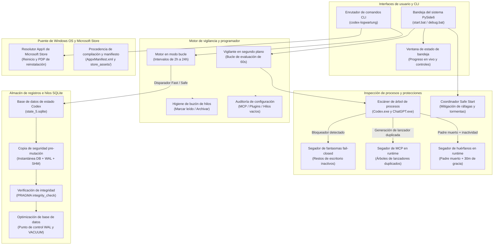
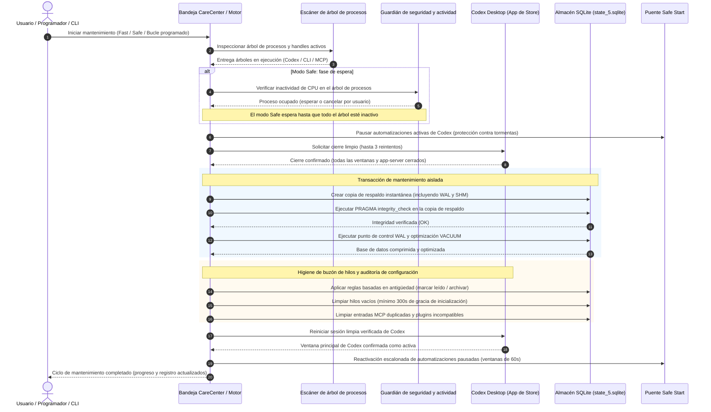
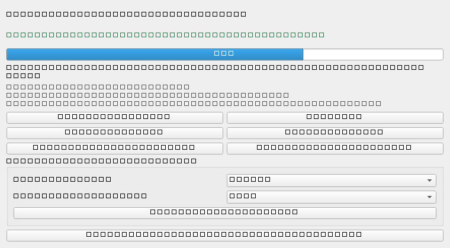

# CareCenter for Codex

> Utilidad no oficial para la bandeja de Windows y CLI que mantiene saludable la aplicación de escritorio OpenAI Codex: repara inicios fallidos, elimina restos colgados y mantiene de forma segura la base de datos local de registros SQLite. Totalmente local, sin telemetría.

[](https://github.com/dev-bricks/CareCenter-for-Codex/actions/workflows/tests.yml)
[](https://github.com/dev-bricks/CareCenter-for-Codex)
[](https://github.com/dev-bricks/CareCenter-for-Codex/releases)
[](https://www.python.org/)
[](https://github.com/dev-bricks/CareCenter-for-Codex)
[](SECURITY.md)
[](SECURITY.md)
[](SECURITY.md)
[](https://github.com/astral-sh/ruff)
[](LICENSE)
[](NOTICE)
[](THIRD_PARTY_LICENSES.md)
[](THIRD_PARTY_LICENSES.txt)
[](locales/)
[](assets/)
[](https://pypi.org/project/PySide6/)
[](https://github.com/dev-bricks)
[](https://github.com/open-bricks)
[](llms.txt)
[](CHANGELOG.md)
[](CHANGELOG.md)

[English](README.md) · [Deutsch](README.de.md) · [Español](README.es.md)

> [!NOTE]
> La arquitectura legible por máquina, los puntos de entrada CLI y las reglas de seguridad están indexadas para agentes de IA en [llms.txt](llms.txt).

Las notas de auditoría local como `BEFUNDE.md` y los archivos de estado temporales `TASKPLAN*.md` se mantienen intencionalmente fuera de Git y no forman parte del contrato público de lanzamiento.

> [!IMPORTANT]
> Esta es una herramienta comunitaria independiente. No ha sido creada por OpenAI, ni está afiliada, respaldada ni patrocinada por OpenAI. "OpenAI" y "Codex" son marcas comerciales de OpenAI y se utilizan aquí únicamente para describir la compatibilidad.

---

### 🧭 Navegación rápida

- [1. Por qué y planteamiento del problema](#por-que--planteamiento-del-problema)
- [2. Arquitectura y flujo del sistema](#arquitectura--flujo-del-sistema)
- [3. Secuencia completa del ciclo de vida](#secuencia-completa-del-ciclo-de-vida)
- [4. Capacidades clave e invariantes de seguridad](#capacidades-clave-e-invariantes-de-seguridad)
- [5. Perfiles destinatarios y detectabilidad](#perfiles-destinatarios-y-detectabilidad)
- [6. Matriz comparativa y alternativas](#matriz-comparativa-y-alternativas)
- [7. Herramientas hermanas y ecosistema asociado](#herramientas-hermanas-y-ecosistema-asociado)
- [8. Características](#caracteristicas)
- [9. Captura de pantalla](#captura-de-pantalla)
- [10. Requisitos](#requisitos)
- [11. Instalación y ejecución](#instalacion-y-ejecucion)
- [12. Uso de la CLI](#uso-de-la-cli)
- [13. Configuración](#configuracion)
- [14. Modelo de seguridad e invariantes](#modelo-de-seguridad-e-invariantes)
- [15. Materiales de Microsoft Store](#materiales-de-microsoft-store)
- [16. Licencias de terceros y transparencia](#licencias-de-terceros-y-transparencia)
- [17. Desarrollo y licencia](#desarrollo-y-licencia)
- [18. Aviso legal (§ 521 BGB) y exención de responsabilidad](#aviso-legal--521-bgb-y-exencion-de-responsabilidad)

---

<a id="sec-01"></a><a id="why--problem-statement"></a><a id="warum--problemstellung"></a><a id="por-que--planteamiento-del-problema"></a>
## Por qué y planteamiento del problema

En Windows, al cerrar la ventana de escritorio de Codex puede quedar rezagado un proceso principal colgado. Ese proceso residual puede retener el bloqueo singleton de la aplicación, haciendo que el siguiente inicio aparentemente no haga nada. CareCenter elimina ese primer obstáculo de forma segura: solo interviene ante procesos fantasma inactivos, archivos de bloqueo huérfanos y rutas de mantenimiento solicitadas explícitamente.

<a id="sec-02"></a><a id="architecture--system-flow"></a><a id="architektur--systemfluss"></a><a id="arquitectura--flujo-del-sistema"></a>
## Arquitectura y flujo del sistema



### Visuelle Vier-Sichten-Architekturtopologie / Topología de cuatro vistas

```text
+==================================================================================================+
|                        CARECENTER FOR CODEX — TOPOLOGÍA DE CUATRO VISTAS                         |
+==================================================================================================+
|                                                                                                  |
|  [VISTA 1: CAPA DE USUARIO, BANDEJA, CLI Y PRESENTACIÓN]                                         |
|  • Bandeja del sistema PySide6 (start.bat / debug.bat) con workers QThread asíncronos reactivos  |
|  • Interfaz multilingüe (ES / EN / DE): Catálogo Tier-2 completo con 322 claves traducidas       |
|  • Ventana de estado en vivo con progreso en tiempo real, registros y controles de cancelación   |
|  • Enrutador CLI sin privilegios (`codex-logwartung status`, `doctor`, `run-safe`, `run-fast`)   |
|  • Suite de iconos multirresolución: ICO Windows 7 capas (16px..256px), master 1024px, PWA/Store|
|                                                                                                  |
+--------------------------------------------------------------------------------------------------+
|                                                                                                  |
|  [VISTA 2: CAPA DE VIGILANTE, PROGRAMADOR Y ORQUESTACIÓN]                                        |
|  • Vigilante en segundo plano: bucle no bloqueante de 60s para detectar restos y huérfanos       |
|  • Programador en bucle: intervalos configurables (2h..24h) con fallback automático Fast/Safe    |
|  • Higiene de buzón de hilos: marcado/archivo por antigüedad; gracia de 300s para hilos vacíos   |
|  • Auditor de configuración: evaluación de 3 estados (off/notify/auto) para MCPs y plugins       |
|  • Coordinador Safe Start: pausa automatizaciones, amortigua tormentas y escalona reinicios (60s)|
|  • Puente Zombie Killer Tray: integración de subprocesos para monitoreo de demonios, PID y logs |
|                                                                                                  |
+--------------------------------------------------------------------------------------------------+
|                                                                                                  |
|  [VISTA 3: CAPA DE PROTECCIONES DE SEGURIDAD Y AISLAMIENTO DE PROCESOS]                          |
|  • Escáner de procesos: detección precisa de árboles Store para `Codex.exe` y `ChatGPT.exe`      |
|  • Segador de fantasmas fail-closed: resuelve bloqueos singleton sin tocar trabajo activo        |
|  • Segador de MCP en runtime: descarta árboles de lanzadores obsoletos y preserva la cohorte viva|
|  • Segador de procesos huérfanos: exige padre muerto, gracia de 30m y doble muestreo de CPU      |
|  • Inmunidad de sesión CLI (INV-SESSIM-04): CLI de Node y ejecuciones `codex exec` protegidas    |
|  • Límite sin privilegios (INV-NOELEV-02): modo usuario estándar (RunAsInvoker), sin avisos UAC  |
|                                                                                                  |
+--------------------------------------------------------------------------------------------------+
|                                                                                                  |
|  [VISTA 4: CAPA DE ALMACENAMIENTO E INTEGRIDAD]                                                  |
|  • Base de datos de estado SQLite: `state_5.sqlite` con historial de conversaciones y ejecución  |
|  • Instantáneas pre-mutación (INV-ATOMIC-05): respaldo atómico de ficheros de diario DB+WAL+SHM  |
|  • Puerta criptográfica (INV-CRYPTO-06): validación obligatoria con `PRAGMA integrity_check`     |
|  • Optimización de base de datos: punto de control WAL limpio y compactación VACUUM              |
|  • Sincronización de estado JSON: gestión transaccional de identificadores no leídos en estado   |
|                                                                                                  |
+==================================================================================================+
|  [PERÍMETRO DE SEGURIDAD LOCAL Y GOBERNANZA]                                                     |
|  • INV-LOCAL-01: 100% Zero-Egress ejecución local        • INV-SLA-10: 487+ tests verdes y 48h SLA|
|  • Acompañante de texto SBOM Nivel 1 (2026-10-08)        • Aviso legal § 521 BGB                 |
+==================================================================================================+
```

<a id="sec-03"></a><a id="complete-lifecycle-sequence"></a><a id="vollstaendiger-lebenszyklus-ablauf"></a><a id="vollständiger-lebenszyklus-ablauf"></a><a id="secuencia-completa-del-ciclo-de-vida"></a>
## Secuencia completa del ciclo de vida



<a id="sec-04"></a><a id="key-capabilities--safety-invariants"></a><a id="kernfaehigkeiten--sicherheitsinvarianten"></a><a id="kernfähigkeiten--sicherheitsinvarianten"></a><a id="capacidades-clave-e-invariantes-de-seguridad"></a>
## Capacidades clave e invariantes de seguridad

| Invariante / Capacidad clave | Garantía arquitectónica | Mecanismo de aplicación | Límite de seguridad |
|---|---|---|---|
| **1. INV-LOCAL-01 (100% Local-First)** | Sin telemetría externa, sin cargas en segundo plano, sin dependencia de la nube | Operación completamente local; todas las rutas residen en el sistema de archivos local | Tráfico de red saliente estrictamente bloqueado; verificación manual (`--live-pages`) aislada |
| **2. INV-NOELEV-02 (Modo usuario sin privilegios)** | La operación estándar no requiere privilegios de administrador | Permisos de usuario no elevados para vigilante, bandeja y mantenimiento de base de datos | Reparaciones administrativas (reinicio AppX de Store) requieren confirmación explícita |
| **3. INV-ISOLAT-03 (Protección de procesos fail-closed)** | Los procesos activos y el trabajo productivo nunca se interrumpen | Medición de delta de CPU en varias etapas y verificación de PID padre | Cualquier actividad de CPU detectada aborta inmediatamente los intentos de terminación |
| **4. INV-SESSIM-04 (Inmunidad de sesión CLI)** | La CLI de Codex basada en Node y las ejecuciones `codex exec` están protegidas | Filtro explícito de CLI y verificación de marcas de tiempo de despliegue | La ejecución activa de CLI bloquea globalmente las escrituras en el almacén de hilos |
| **5. INV-ATOMIC-05 (Instantánea de BD previa a mutación)** | La base de datos SQLite nunca se modifica sin un respaldo verificado | Instantánea completa del archivo de base de datos junto con diarios WAL y SHM | Cualquier fallo de respaldo detiene inmediatamente el mantenimiento antes de VACUUM |
| **6. INV-CRYPTO-06 (Verificación criptográfica de integridad)**| La corrupción de la base de datos se detecta antes de las operaciones de escritura | Ejecución de `PRAGMA integrity_check` directamente sobre la copia de respaldo | Las comprobaciones de integridad fallidas bloquean todas las escrituras posteriores |
| **7. INV-GRACE-07 (Períodos de gracia obligatorios)**| Los procesos nuevos y los hilos vacíos reciben tiempo garantizado para inicializarse | Gracia fija de 30 minutos para huérfanos; mínimo de 300s para hilos vacíos | Las fases de inicialización temprana nunca se malinterpretan como restos colgados |
| **8. INV-STAGGER-08 (Reactivación escalonada)** | La recuperación del sistema no satura Codex con inicios simultáneos de automatizaciones | Retraso configurable (predeterminado: 60s) mediante el coordinador Safe Start | Previene exceder límites de tasa de API y picos locales de carga de CPU |
| **9. INV-NONDEST-09 (Corrección de AppX no destructiva)**| La reparación de paquetes de Microsoft Store protege los datos personales del usuario | Escalación acotada: limpieza sin admin -> sugerencia con admin -> página de reinstalación | Los reinicios destructivos automáticos o la eliminación de paquetes están prohibidos |
| **10. INV-SLA-10 (Paridad estricta de verificación)** | Suite de pruebas 100% verde, linters limpios y contratos de metadatos sincrónicos | Matriz de CI automatizada, suite pytest (487+ superadas | 100% verde), Ruff y compileall | Cada cambio exige una verificación completa y sin errores antes de confirmar el commit |

<a id="sec-05"></a><a id="target-personas--discoverability"></a><a id="zielgruppen--auffindbarkeit"></a><a id="perfiles-destinatarios-y-detectabilidad"></a>
## Perfiles destinatarios y detectabilidad

CareCenter for Codex está diseñado para cuatro grupos principales de usuarios en el ecosistema de desarrollo de escritorio de Windows:

| Perfil destinatario / Persona | Perfil e intención | Problema principal | Solución CareCenter y flujos |
|---|---|---|---|
| **1. Desarrolladores individuales e ingenieros de IA** | Usuarios avanzados que realizan ciclos iterativos de desarrollo con OpenAI Codex Desktop en Windows 10/11. Equipos multilingües (alemán, inglés, español). | La aplicación no inicia silenciosamente tras cerrar la ventana debido a bloqueos singleton o procesos fantasma colgados. | Reparación en bandeja con 1 clic, limpieza automática de procesos fantasma (`Codex.exe` / `ChatGPT.exe`), interfaz multilingüe Tier-2 y reinicio seguro sin perder contexto. |
| **2. Integradores de DevOps y herramientas** | Ingenieros que automatizan entornos de desarrollo, ejecutores de CI y scripts de mantenimiento de estaciones de trabajo. | La finalización manual interrumpe sesiones activas de CLI; los avisos de UAC bloquean tareas automatizadas en segundo plano. | CLI en modo usuario sin privilegios (`codex-logwartung`), protección fail-closed de CLI (`INV-SESSIM-04`) y bucle de demonio consistente. |
| **3. Defensores de privacidad y Local-First** | Desarrolladores conscientes de la seguridad que exigen control total de sus datos y límites estrictos de ejecución local. | Limpiadores de terceros con telemetría, controladores invasivos y dependencias opacas en la nube. | Arquitectura estricta Zero-Egress (`INV-LOCAL-01`), sin tráfico de red, con VACUUM y puntos de control WAL de SQLite transparentes. |
| **4. Soporte de TI y administradores de sistemas** | Profesionales de TI que administran estaciones de trabajo de desarrollo con aplicaciones de Microsoft Store en Windows. | Estados de paquetes AppX dañados, saturación del almacén de hilos (`state_5.sqlite`) y procesos huérfanos en segundo plano. | Escalación acotada de reparación de Store, instantáneas de base de datos pre-mutación (`INV-ATOMIC-05`) y comprobantes de inicio auditables. |

#### Palabras clave de búsqueda y detectabilidad (High-Intent Keywords)
- **Español:** `reparación openai codex windows`, `codex desktop no inicia`, `limpiar bloqueo singleton codex`, `terminar procesos colgados codex`, `mantenimiento sqlite codex vacuum`, `utilidad bandeja pyside6`, `guardián procesos segundo plano codex`, `utilidad local sin telemetría`
- **Inglés:** `openai codex repair windows`, `codex desktop failed to start`, `codex singleton lock cleanup`, `kill hung codex process`, `codex sqlite vacuum maintenance`, `pyside6 tray developer tools`, `codex desktop background reaper`, `local-first zero-telemetry tray`
- **Alemán:** `OpenAI Codex Reparatur Windows`, `Codex Desktop startet nicht`, `Codex Singleton Lock bereinigen`, `hängende Codex Prozesse beenden`, `Codex SQLite Datenbank Wartung`, `PySide6 System Tray Werkzeug`, `Codex Hintergrundprozess Wächter`, `Lokal-Erstmals Desktop Werkzeug`

<a id="sec-06"></a><a id="comparative-matrix--alternatives"></a><a id="vergleichsmatrix--alternativen"></a><a id="matriz-comparativa-y-alternativas"></a>
## Matriz comparativa y alternativas

La siguiente matriz compara CareCenter for Codex con otros enfoques operativos en 10 dimensiones arquitectónicas y funcionales:

| Función y dimensión | CareCenter for Codex | Administrador de tareas de Windows | Scripts ad-hoc (Batch/PS) | Limpiadores genéricos (CCleaner) | Reinstalación de Codex |
|---|---|---|---|---|---|
| **1. 100% Local-First y Zero-Egress** | **Garantía total** (`INV-LOCAL-01`, sin telemetría) | Herramienta offline, sin red | Dependiente del script, casi siempre local | ❌ Telemetría y nube integradas | Requiere descarga desde la nube |
| **2. Sin privilegios (`RunAsInvoker`)** | **Espacio de usuario puro** (`INV-NOELEV-02`, sin UAC) | ⚠️ A menudo exige admin para apps de Store | ⚠️ A menudo exige UAC para forzar cierre | ❌ Requiere privilegios de administrador/UAC | ❌ Requiere permisos de admin o Store |
| **3. Limpieza de procesos fantasma inactivos** | **Selectiva y protegida** (`INV-ISOLAT-03`) | ❌ Terminación manual indiscriminada | ❌ `taskkill /F` a ciegas interrumpe trabajo | ❌ Ignora estados de bloqueo | ❌ El proceso debe cerrarse primero |
| **4. Inmunidad de sesión CLI y de agentes** | **Garantizada** (`INV-SESSIM-04`, CLI protegida) | ❌ Cierra procesos secundarios a ciegas | ❌ Cierra todos los procesos del mismo nombre | ❌ No distingue árboles de CLI/Node | ❌ Interrumpe todas las tareas activas |
| **5. Mantenimiento atómico de base de datos SQLite** | **Copia completa + integridad WAL** (`INV-ATOMIC-05`) | ❌ Sin relación con bases de datos | ❌ Scripting complejo y propenso a errores | ❌ Borrado ciego de archivos (pérdida de datos)| ❌ Sobrescribe o borra la BD de estado |
| **6. Comprobación criptográfica de integridad** | **PRAGMA integrity_check** (`INV-CRYPTO-06`) | ❌ Ninguna | ❌ Ninguna | ❌ Ninguna | ❌ Ninguna |
| **7. Fallback Safe Start y control de inicio** | **Integrado** (`safe-start-for-codex`) | ❌ Ninguno | ❌ Ninguno | ❌ Ninguno | ❌ Ninguno |
| **8. Interfaz asíncrona de bandeja en PySide6** | **Arquitectura QThread reactiva** | Vista básica del Administrador de tareas | ❌ Solo consola / headless | Interfaz pesada propietaria | Interfaz de Microsoft Store |
| **9. Ruta de reparación AppX de MS Store** | **Escalación acotada y diagnóstico** | Solo finalizar / restablecer | Comandos manuales de PowerShell AppX | ❌ No compatible | Reinstalación completa desde Store |
| **10. SLA de seguridad y pruebas de contrato** | **SLA de 48h y suite pytest 487+ (100% verde)** | No aplicable | ❌ Sin arnés de pruebas | ❌ Código cerrado propietario | Binario de código cerrado |

<a id="sec-07"></a><a id="sibling-ecosystem--partner-tools"></a><a id="geschwisterwerkzeuge--partner-oekosystem"></a><a id="geschwisterwerkzeuge--partner-ökosystem"></a><a id="herramientas-hermanas-y-ecosistema-asociado"></a>
## Herramientas hermanas y ecosistema asociado

| Herramienta hermana | Organización | Rol y función | Integración con CareCenter |
|---|---|---|---|
| **[safe-start-for-codex](https://github.com/dev-bricks/safe-start-for-codex)** | dev-bricks | Control de inicio, mitigación de ráfagas y pausa selectiva de automatizaciones | Dependencia central; coordina tormentas de inicio y reactivación escalonada |
| **[MethodenAnalyser](https://github.com/dev-bricks/MethodenAnalyser)** | dev-bricks | Análisis estático AST, extracción de clases/métodos y complejidad de código | Verifica salud de código, alcance de refactorizaciones y estructura modular |
| **[companion-for-agy](https://github.com/ellmos-ai/companion-for-agy)** | ellmos-ai | Puente ConPTY de Windows, demonio pseudoterminal y supervisión de sesiones | Comparte invariantes de aislamiento y protege tareas en segundo plano de agentes |
| **[lock-master](https://github.com/dev-bricks/lock-master)** | dev-bricks | Mecanismos de bloqueo multiagente, cachés de bloqueo y reserva de archivos | Garantiza acceso sin colisiones entre agentes autónomos concurrentes |
| **[bach](https://github.com/ellmos-ai/bach)** | ellmos-ai | Orquestador de arquitectura mental y motor de descomposición de tareas | Coordina flujos de trabajo multiagente complejos y tareas de flotas |
| **[usmc](https://github.com/ellmos-ai/usmc)** | ellmos-ai | Mando y control unificado de misiones y panel de operaciones | Agrega estados de sistema, métricas operativas y alertas |
| **[clutch](https://github.com/ellmos-ai/clutch)** | ellmos-ai | Gestor de hooks de herramientas, hooks de Git y control semántico de ejecución| Administra hooks de desarrollo y verificaciones de gobernanza pre-commit |
| **[open-compute](https://github.com/ellmos-ai/open-compute)** | ellmos-ai | Agente autónomo de uso de computadora y ejecutor multiplataforma de SO | Se apoya en entornos de procesos limpios asegurados por CareCenter |
| **[system-auditor](https://github.com/ellmos-ai/system-auditor)** | ellmos-ai | Motor de diagnóstico multihost y comprobador de estado de hosts | Monitorea entornos globales del sistema, higiene de archivos y procesos |
| **[CloudLockFixer](https://github.com/file-bricks/CloudLockFixer)** | file-bricks | Desbloqueador de sincronización en la nube y gestor de copias en conflicto | Resuelve bloqueos de sincronización en la nube sin pérdida de datos |
| **[SoftwareCenter](https://github.com/file-bricks/SoftwareCenter)** | file-bricks | Catálogo central de software PySide6 y administración de escritorio | Organiza e inicia utilidades de escritorio, incluyendo CareCenter y Safe Start |
| **[DokuZen](https://github.com/doc-bricks/DokuZen)** | doc-bricks | Procesamiento documental, OCR, redacción automática e higiene de PDFs | Complementa flujos locales con seguridad documental sobria y sin red |

## Herramientas relacionadas

Estas son utilidades independientes; CareCenter permanece enfocado en el mantenimiento de la aplicación de escritorio de Codex.

- [COMA](https://github.com/ellmos-ai/coma) permite coordinar tareas de agentes mediante archivos locales, inicio de procesos y consulta de estado.
- [agent-ops-stack](https://github.com/ellmos-ai/agent-ops-stack) es una plantilla de obtención basada en manifiestos Git para módulos CLI locales de agentes; su configuración se describe en las instrucciones de cada módulo.

<a id="sec-08"></a><a id="features"></a><a id="funktionen"></a><a id="caracteristicas"></a>
## Características

- Vigilante en segundo plano: comprueba cada 60 segundos si existen bloqueadores de inicio antiguos, huérfanos desprendidos en runtime o generaciones duplicadas de procesos MCP en tiempo de ejecución. La limpieza de huérfanos exige un padre muerto, un período de gracia fijo de 30 minutos y dos muestras de CPU. Se reconocen nodos MCP permitidos y servidores de lenguaje habituales. Las ejecuciones desprendidas de `codex exec` permanecen protegidas mientras su tiempo de CPU siga aumentando, su despliegue de sesión tenga menos de dos minutos o su archivo de salida `--output-last-message` aún esté pendiente. Cada terminación exitosa cierra el árbol de procesos completo (`taskkill /T`) y registra el subproceso, la última identidad conocida del padre y el criterio en `app.log`. Un padre vivo indica una cohorte activa y nunca se finaliza.
- Selector de idioma en bandeja y localización Tier-2 al español: En la sección de configuración se puede alternar entre español, inglés y alemán. El catálogo en español Tier-2 (`es`) cubre las 322 claves de interfaz con una cadena de reserva de 4 etapas (`idioma activo -> en -> de -> clave`). La preferencia se guarda en `config.json` y la interfaz de la bandeja se actualiza de inmediato sin reiniciar. La paridad de traducción se mantiene verificada mediante la CLI `manage_translations.py`.
- Suite de iconos y recursos multirresolución: Icono auténtico de Windows de 7 capas ICO (16x16 hasta 256x256 @ 32bpp RGBA), master PNG de 1024x1024, suite móvil PWA (`icon-192.png`, `icon-512.png`, iconos enmascarables) y mosaicos de Microsoft Store, cargados limpiamente mediante el componente `app_icon_loader.py` con fallback seguro para entornos headless.
- Puente para demonio Zombie Killer Tray: Integrado con `zombie-killer-tray` para la supervisión demonizada de procesos en segundo plano, protección contra PIDs no positivos y registro de eventos sin requerir permisos de administrador.
- Control de automatizaciones desde la bandeja: apagar todas las automatizaciones de Codex activas, reactivar únicamente las desactivadas por CCC o encenderlas de inmediato o de manera escalonada. El intervalo es configurable mediante `automation_stagger_delay_seconds` (predeterminado: 60 segundos).
- Higiene del buzón de hilos: marcar todos como leídos, marcar hilos no leídos con más de X días de antigüedad y archivar hilos automáticamente tras un período configurable por separado. La autocorrección de hilos vacíos espera al menos 300 segundos para que las nuevas sesiones CLI/escritorio puedan completar su primera escritura. Las mutaciones se bloquean si hay actividad de la app de escritorio o de la CLI npm de Codex, se vuelven a comprobar antes del respaldo/traslado y solo se aplican con copias de seguridad, escritura atómica de estado y archivado transaccional.
- La limpieza de auditoría ofrece tres modos independientes `off` / `notify` / `auto` para entradas duplicadas de configuración MCP, plugins inutilizables en Windows e hilos vacíos. La auditoría manual ejecuta adicionalmente el segador conservador de MCP en runtime, incluso si el renderizador de escritorio está en ejecución; las modificaciones de configuración e hilos se posponen hasta que Codex se cierre por completo.
- Modo en bucle: selección entre 2, 3, 5, 7, 10, 12 o 24 horas. Cada ciclo periódico se inicia con mantenimiento rápido (Fast) y reintenta los cierres fallidos de Codex hasta 3 veces por defecto. Si el cierre sigue fallando, el modo Safe pasa a ser un intento de recuperación extendido y el contador del bucle vuelve a empezar; si Safe concluye con éxito antes de agotarse ese tiempo, el contador se reinicia a partir del éxito verificado con reinicio de Codex. Si el contador vence mientras Safe continúa esperando, Safe se detiene y comienza el siguiente ciclo Fast programado. Las automatizaciones se pausan únicamente tras un mantenimiento exitoso y solo se reanudan en ventanas escalonadas de 60 segundos.
- Inicios directos desde la bandeja: "Iniciar Codex seguro" ejecuta Safe Start for Codex en su propia bandeja y adopta su `config.json`; si falta dicha configuración, CareCenter aplica un intervalo de 1 minuto para ese inicio. Si Safe Start ya está en ejecución, no se genera un segundo proceso. "Iniciar Codex" arranca Codex normalmente sin el control de Safe Start; si Safe Start está activo, CareCenter solo reanuda las automatizaciones pausadas por él y no abre otra ventana de Codex.
- Acción de un solo clic "Reparar Codex": inicia una escalación acotada que se detiene tan pronto como Codex vuelve a iniciar. En primer lugar, se ejecuta una reparación sin privilegios de administrador; el reinicio con administrador, la reinstalación desde Store o el reinicio del equipo solo se sugieren en caso estrictamente necesario.
- Compatibilidad moderna con procesos de Microsoft Store: Reconoce tanto árboles Electron clásicos con `Codex.exe` como árboles modernos de Store denominados `ChatGPT.exe` junto a su servidor de aplicaciones integrado, sin confundir CareCenter con la propia aplicación Codex.
- Dos modalidades de mantenimiento:
  - Safe espera a que todo el árbol de procesos de Codex esté inactivo, permite cancelarse en cualquier momento durante la espera, cierra Codex limpiamente, ejecuta el mantenimiento y lo reinicia después.
  - Fast cierra Codex de inmediato y arranca el mantenimiento a continuación.
- Herramientas de Store: reparan rutas de actualización atascadas en Microsoft Store y abren la página oficial de la tienda para una reinstalación limpia en caso necesario.
- Mantenimiento conservador de bases de datos: copia de respaldo completa con WAL/SHM, comprobación de integridad en el respaldo, punto de control WAL, `PRAGMA optimize`, `VACUUM` y retención acotada de copias de seguridad.
- Ventana de estado con barra de progreso, tooltip dinámico en la bandeja y registros de auditoría persistentes.
- Safe Start for Codex se distribuye como dependencia integrada y puede instalarse o actualizarse desde la ventana de CareCenter, desde la bandeja o mediante la CLI. CareCenter lo utiliza para absorber ráfagas de lanzamiento, tormentas de inicio y avisos de recuperación.

<a id="sec-09"></a><a id="screenshot"></a><a id="bildschirmfoto"></a><a id="captura-de-pantalla"></a>
## Captura de pantalla

La ventana de estado de la bandeja muestra el estado operativo actual, contador de restos eliminados, progreso, controles de mantenimiento con cancelación en modo Safe, modo bucle, acciones de Store, acciones de Safe Start, control de automatizaciones y ajustes de configuración.



Para regenerar la captura de pantalla directamente desde la ventana PySide6 real:

```powershell
$env:PYTHONPATH="src"
python -m codex_logdatenbank_wartung.cli store-screenshot
```

<a id="sec-10"></a><a id="requirements"></a><a id="voraussetzungen"></a><a id="requisitos"></a>
## Requisitos

- Windows 10 o Windows 11
- Python 3.12+ al ejecutar desde el código fuente
- [PySide6](https://pypi.org/project/PySide6/) para la interfaz de bandeja

Las versiones compiladas en archivo EXE independiente no requieren una instalación separada de Python.

<a id="sec-11"></a><a id="install-and-run"></a><a id="installation-und-start"></a><a id="instalacion-y-ejecucion"></a>
## Instalación y ejecución

Desde el código fuente:

```powershell
$env:PYTHONPATH="$PWD\src"
pip install -r requirements.txt
python -m codex_logdatenbank_wartung.cli status
python -m codex_logdatenbank_wartung.cli tray
```

Para el inicio habitual de la bandeja desde el repositorio se utiliza `start.bat`. Este script inicia la aplicación sin ventana mediante `pythonw.exe` y registra posibles errores de inicio en `%LOCALAPPDATA%\CareCenterForCodex\logs\app.log`. Para tareas de diagnóstico con consola visible está disponible `debug.bat`.

Compilar un ejecutable EXE independiente:

```powershell
build_exe.bat
```

Para una compilación controlada fuera de producción, redefina ambas rutas locales de salida:

```powershell
$env:CARECENTER_DIST_DIR = "C:\_Local_DEV\codex_build\artifacts\carecenter"
$env:CARECENTER_BUILD_ROOT = "C:\_Local_DEV\codex_build\work\carecenter"
build_exe.bat
```

El proceso de compilación rechaza cambios rastreados que no hayan sido confirmados en Git. Integra en el binario EXE la versión del proyecto, el commit de Git y la fecha de compilación en UTC, generando a su lado `CareCenterForCodex.provenance.json` con el tamaño y la suma SHA-256 del artefacto. Los comandos `status`, `doctor` y el registro de arranque de la bandeja informan de la identidad integrada en la compilación.

Por defecto, la compilación utiliza la fuente pública de Safe Start en GitHub fijada a un commit exacto en `pyproject.toml`. De esta manera se preserva la reproducibilidad sin incrustar inadvertidamente un directorio de trabajo local con modificaciones no comprometidas. Para utilizar intencionadamente una copia local de Safe Start:

```powershell
$env:CARECENTER_SAFE_START_SOURCE = "C:\ruta\a\REL-PUB_safe-start-for-codex"
build_exe.bat
```

El mismo patrón se aplica a la integración opcional de [zombie-killer-tray](https://github.com/dev-bricks/zombie-killer-tray) (limpieza conservadora de procesos huérfanos MCP y servidores de lenguaje, ejecutado como subproceso propio mediante `zombie-killer-watch`): fijada a un commit exacto por defecto, anulable para un clon local mediante `$env:CARECENTER_ZOMBIE_KILLER_SOURCE`.

<a id="sec-12"></a><a id="cli-usage"></a><a id="cli-befehle"></a><a id="uso-de-la-cli"></a>
## Uso de la CLI

```powershell
python -m codex_logdatenbank_wartung.cli doctor
python -m codex_logdatenbank_wartung.cli repair --dry-run
python -m codex_logdatenbank_wartung.cli repair --execute
python -m codex_logdatenbank_wartung.cli dry-run
python -m codex_logdatenbank_wartung.cli maintain --execute
python -m codex_logdatenbank_wartung.cli auto-maintain --mode safe --execute
python -m codex_logdatenbank_wartung.cli fast-loop-cycle --execute
python -m codex_logdatenbank_wartung.cli mark-runs-read --dry-run
python -m codex_logdatenbank_wartung.cli mark-runs-read --older-than-days 2
python -m codex_logdatenbank_wartung.cli mark-runs-read --older-than-days 2 --archive-older-than-days 10
python -m codex_logdatenbank_wartung.cli startup-receipt C:\ruta\rollout.jsonl --boot-file GPT=C:\ruta\GPT.md --format json
python -m codex_logdatenbank_wartung.cli store-repair --level repair --execute
python -m codex_logdatenbank_wartung.cli store-materials
python -m codex_logdatenbank_wartung.cli safe-start-report
python -m codex_logdatenbank_wartung.cli safe-start-install
python -m codex_logdatenbank_wartung.cli zombie-killer-report
python -m codex_logdatenbank_wartung.cli zombie-killer-install
python -m codex_logdatenbank_wartung.cli zombie-killer-watch
python -m codex_logdatenbank_wartung.cli zombie-killer-stop
python -m codex_logdatenbank_wartung.cli schedule install --interval-minutes 180
```

La CLI lee `language` desde `config.json` para la emisión de informes en tiempo de ejecución. La forma recomendada para cambiar de idioma de manera persistente es el menú de configuración en la bandeja.

`startup-receipt` lee exclusivamente hasta el primer límite de asistente del archivo de despliegue especificado de forma explícita. La salida incluye metadatos, recuentos de caracteres/bytes y sumas SHA-256, sin exponer contenido de prompts. Las fuentes externas `--boot-file ETIQUETA=RUTA` se presentan únicamente como instantáneas con `injection_claim=false`, nunca como prueba demostrada de inyección en Codex.

En los ajustes de la bandeja, el valor `0` desactiva una regla de antigüedad. Configure `auto_mark_threads_read_days` y `auto_archive_threads_days` con valores independientes (por ejemplo, `2` y `10`). CareCenter aplica estas reglas durante las comprobaciones del vigilante en segundo plano en cuanto Codex está completamente cerrado.

<a id="sec-13"></a><a id="configuration"></a><a id="konfiguration"></a><a id="configuracion"></a>
## Configuración

La configuración, registros y copias de seguridad residen por defecto fuera de carpetas sincronizadas en la nube:

```text
config:   %LOCALAPPDATA%\CareCenterForCodex\config.json
logs:     %LOCALAPPDATA%\CareCenterForCodex\logs\
backups:  %LOCALAPPDATA%\CareCenterForCodex\backups\
database: %USERPROFILE%\.codex\logs_2.sqlite
```

Las rutas de Codex se detectan automáticamente a partir de `%LOCALAPPDATA%`, `%APPDATA%` y `CODEX_HOME`. Las nuevas instalaciones ubican los datos de CareCenter bajo `%LOCALAPPDATA%\CareCenterForCodex` de manera predeterminada. Las instalaciones locales existentes bajo `C:\_Local_DEV\codex-maintenance\` se reutilizan automáticamente como fallback heredado. Es posible anular cada una de las rutas dentro de `config.json`.

La detección de candidatos MCP en tiempo de ejecución está activa por defecto a través de `reap_runtime_mcp_duplicates`. Sus valores predeterminados conservadores establecen una antigüedad mínima configurable de 3600 segundos (una hora) para la raíz de cada candidato, un intervalo de cohorte de lanzamiento de 90 segundos, una ventana de lanzador de 30 segundos, al menos dos firmas MCP distintas repetidas y un segundo de muestreo de actividad de CPU. La eliminación requiere adicionalmente que el proceso padre esté inactivo; una cohorte viva del servidor de aplicaciones de Store nunca es terminada. Todos los umbrales pueden ajustarse en `config.json`.

La limpieza de huérfanos en runtime conserva el prefijo de compatibilidad `reap_companion_orphans`. `companion_orphan_min_age_seconds` tiene un umbral mínimo estricto de seguridad de 1800 segundos; el muestreo de CPU es de 5 segundos por defecto y la ventana de frescura de despliegue de sesión es de 120 segundos. El intervalo entre las dos mediciones de CPU no puede reducirse por debajo de 2 segundos, y la ventana de despliegue no puede acortarse por debajo de 120 segundos.

`audit_empty_thread_min_age_seconds` está configurado por defecto en 300 segundos. Los valores inferiores se ajustan a esa gracia conservadora de inicialización; los valores superiores la extienden.

Para utilizar una raíz de datos diferente (útil en pruebas o instalaciones alternativas), defina la variable `CCC_DATA_ROOT` antes de arrancar:

```powershell
$env:CCC_DATA_ROOT = "D:\mi-mantenimiento-codex"
python -m codex_logdatenbank_wartung.cli tray
```

Al configurarse, `config.json`, `logs\` y `backups\` se ubican bajo esa ruta en lugar del directorio predeterminado `%LOCALAPPDATA%\CareCenterForCodex\`.

<a id="sec-14"></a><a id="safety-model--invariants"></a><a id="sicherheitsmodell--invarianten"></a><a id="modelo-de-seguridad-e-invariantes"></a>
## Modelo de seguridad e invariantes

- La ejecución normal de CareCenter y los comandos CLI predeterminados operan exclusivamente de forma local (`local-only` / `normal runtime`): no transmiten telemetría, no suben datos, no realizan llamadas a APIs externas ni utilizan sincronización en la nube.
- El mantenimiento conservador se bloquea mientras Codex permanezca en ejecución.
- El mantenimiento programado nunca cierra Codex.
- El automantenimiento en modo Safe cierra Codex únicamente después de comprobar que todo el árbol de procesos está inactivo.
- La cancelación en modo Safe solo interrumpe el período de espera previo al cierre de Codex; las operaciones activas sobre la base de datos nunca se interrumpen forzosamente.
- El vigilante elimina procesos fantasma inactivos sin renderizador únicamente tras superar el umbral de antigüedad configurado.
- La detección de duplicados MCP en runtime conserva siempre la cohorte de lanzamiento más reciente e ignora árboles de candidatos cuyos contadores de CPU sigan avanzando; un proceso padre vivo constituye un criterio absoluto de no terminación.
- La limpieza de huérfanos en runtime exige que el padre esté muerto, así como evidencias de antigüedad e inactividad de CPU. Un proceso `codex exec` desprendido queda adicionalmente excluido mientras presente actividad de CPU, un despliegue reciente o una señal de salida pendiente; si carece de contrato `--output-last-message`, se excluye preventivamente de forma fail-closed. Los nodos MCP inactivos con padre muerto y los servidores de lenguaje comunes permanecen como objetivos de limpieza, registrando la última identidad conocida del padre en el log de auditoría.
- El servidor de aplicaciones de escritorio de Codex, los procesos secundarios no relacionados, el trabajo activo en la CLI de Codex y el uso activo del escritorio quedan totalmente excluidos de las terminaciones de procesos. El detector de solo lectura trata la actividad de la aplicación de escritorio y de la CLI de npm como bloqueador de mutaciones del almacén de hilos.
- Las rutas de acción destructivas como el restablecimiento de la Store, la reparación con privilegios de administrador, la reinstalación y el reinicio del sistema son únicamente sugerencias o acciones voluntarias del usuario, nunca sorpresas automáticas.
- El [Contrato de intercambio de salud de CareCenter v1](CARE_CENTER_EXCHANGE_CONTRACT.md) define una instantánea de solo lectura con privacidad minimizada para BACH/OCEAN. No habilita transporte en tiempo de ejecución, comandos entrantes, telemetría ni facultades de mantenimiento remoto.

<a id="sec-15"></a><a id="windows-store-materials"></a><a id="windows-store-materialien"></a><a id="materiales-de-microsoft-store"></a>
## Materiales de Microsoft Store

El proyecto incluye la base necesaria para la publicación y empaquetado en Microsoft Store:

- `store_package.json`
- `STORE_LISTING.md`
- `PRIVACY_POLICY.md`
- `SUPPORT.md`
- `docs/privacy.md`
- `docs/support.md`
- `AppxManifest.xml` con cuatro fuentes canónicas de logotipos de paquete bajo `store_assets/`

Páginas públicas de la Store:

- Privacidad: `https://dev-bricks.github.io/CareCenter-for-Codex/privacy`
- Soporte: `https://dev-bricks.github.io/CareCenter-for-Codex/support`

Validación con la herramienta integrada:

```powershell
python -m codex_logdatenbank_wartung.cli store-materials
python -m codex_logdatenbank_wartung.cli store-materials --live-pages
python -m codex_logdatenbank_wartung.cli store-materials --exe-path C:\_Local_DEV\codex-maintenance\bin
```

El comando ejecutado sin `--live-pages` realiza una verificación puramente local de los materiales y no contacta con ninguna URL. `--live-pages` es una verificación previa manual de lanzamiento totalmente independiente: únicamente esta ruta opt-in consulta ambas URLs de la Store configuradas a través de HTTPS y reporta páginas inaccesibles en forma de advertencia. No forma parte de la bandeja, del vigilante, del mantenimiento ni del tiempo de ejecución CLI normal, ni constituye telemetría. Sin el argumento `--exe-path`, la verificación intenta localizar automáticamente el archivo ejecutable compilado desde `build_exe.bat` (`DIST_DIR`). Con `--exe-path`, es posible suministrar tanto el archivo `.exe` específico como el directorio de compilación.

La verificación previa local analiza `AppxManifest.xml`, coteja la identidad del paquete, el editor, la versión, el ejecutable y el nombre para mostrar con `store_package.json`, y vincula las referencias preparadas en `icons/` con las fuentes de `store_assets/` del compilador central. Cualquier logotipo ausente o que escape del directorio de origen provoca un fallo de validación.

Las URLs de privacidad y soporte están preparadas para GitHub Pages. `store-materials` también genera una compilación estática temporal de Pages y valida `privacy/index.html`, `support/index.html`, `index.html` y el marcador de compilación. El artefacto puede compilarse de forma explícita mediante:

```powershell
python scripts\build_store_pages.py --output _site
```

El flujo de trabajo activo `.github/workflows/pages.yml` publica las rutas `/privacy/` y `/support/` a través de GitHub Pages.

<a id="sec-16"></a><a id="third-party-licenses--transparency"></a><a id="drittanbieter-lizenzen--transparenz"></a><a id="licencias-de-terceros-y-transparencia"></a>
## Licencias de terceros y transparencia

CareCenter for Codex mantiene una transparencia total de licencias y una estricta conformidad de distribución:

- **Aplicación principal:** Licenciada bajo la permisiva [Licencia MIT](LICENSE).
- **Subsistema de GUI:** Desarrollado con **PySide6** (`>=6.7`), vinculado dinámicamente en estricto cumplimiento de la **Licencia Pública General Reducida de GNU v3 (LGPL-3.0-only)**. No se modifica ni redistribuye código fuente de Qt6/PySide6 de forma propietaria. Los usuarios conservan la libertad de revincular o sustituir las bibliotecas de tiempo de ejecución de PySide6 instaladas.
- **Motor de configuración:** Basado en **tomlkit** bajo la **Licencia MIT**.
- **Herramientas de compilación e integración:** Integración con Safe Start (`safe-start-for-codex`, MIT), integración con zombie-killer-tray (`zombie-killer-tray`, MIT), empaquetado con PyInstaller (GPLv2 con excepción de PyInstaller) y Hatchling (MIT).
- **Documento de auditoría e invariantes:** Se mantiene una auditoría exhaustiva de todas las dependencias de tiempo de ejecución, desarrollo y biblioteca estándar, junto a las 10 Invariantes de Seguridad y Gobernanza, en [THIRD_PARTY_LICENSES.md](THIRD_PARTY_LICENSES.md) (versión 2026-10-08). El inventario complementario canónico en texto plano SBOM Nivel 1 se documenta en [THIRD_PARTY_LICENSES.txt](THIRD_PARTY_LICENSES.txt) (versión 2026-10-08).

<a id="sec-17"></a><a id="development--license"></a><a id="entwicklung--lizenz"></a><a id="desarrollo-y-licencia"></a>
## Desarrollo y licencia

### Desarrollo

```powershell
$env:PYTHONPATH="src"
python -m pytest
python -m ruff check src tests
python -m compileall src tests
```

La suite de pruebas cubre la seguridad del mantenimiento, la escalación de reparaciones, la integración con Safe Start, la supervisión de Zombie Killer Tray, el control de automatizaciones, la validación de materiales de Store, la carga de configuración, la paridad de traducción Tier-2 en español, la carga de recursos multirresolución y la persistencia del idioma en la bandeja (487+ pruebas superadas | 100% verde).

### Licencia

CareCenter for Codex se distribuye bajo la [Licencia MIT](LICENSE). PySide6 se utiliza bajo la licencia LGPL; el inventario de dependencias directas y su alcance de auditoría se encuentran detallados en [THIRD_PARTY_LICENSES.txt](THIRD_PARTY_LICENSES.txt).

<a id="sec-18"></a><a id="statutory-notice--521-bgb--liability-disclaimer"></a><a id="gesetzlicher-hinweis--521-bgb--haftungsausschluss"></a><a id="aviso-legal--521-bgb-y-exencion-de-responsabilidad"></a>
## Aviso legal (§ 521 BGB) y exención de responsabilidad

### Limitación legal de responsabilidad (§ 521 BGB - Prestación gratuita)
Este software y los arneses de automatización asociados se proporcionan de forma gratuita sin contraprestación comercial. De conformidad con la legislación civil alemana (§ 521 BGB - *Gefälligkeitsrecht*), la responsabilidad del autor y de los colaboradores queda estrictamente limitada al dolo (*Vorsatz*) y a la negligencia grave (*grobe Fahrlässigkeit*). El software se suministra "tal cual" ("as is"), sin garantías de ninguna clase, expresas o implícitas.

### SLA de respuesta de seguridad
Las notificaciones de vulnerabilidades de seguridad se coordinan con arreglo a [`SECURITY.md`](SECURITY.md), con un tiempo de acuse de recibo garantizado de 48 horas y un compromiso de triaje máximo de 5 días hábiles.
